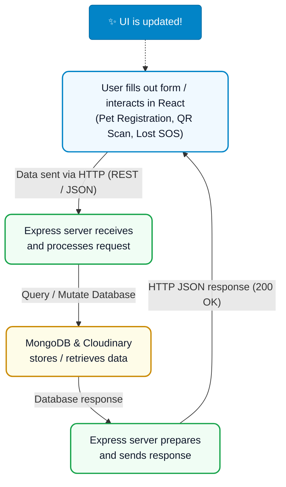
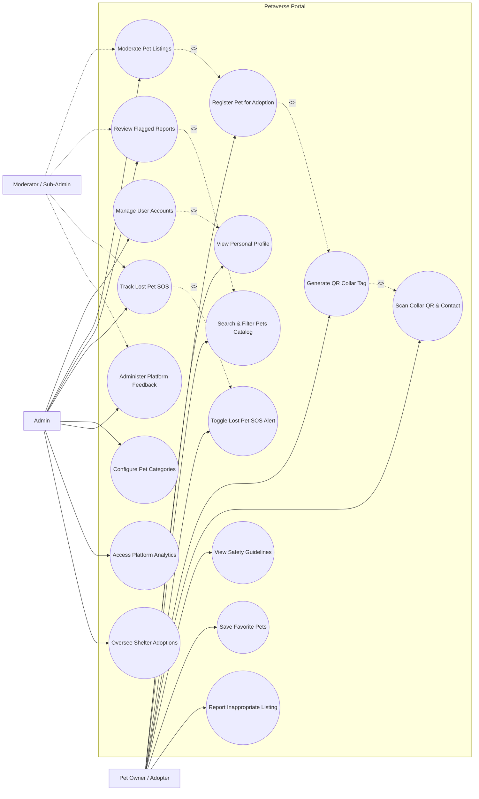
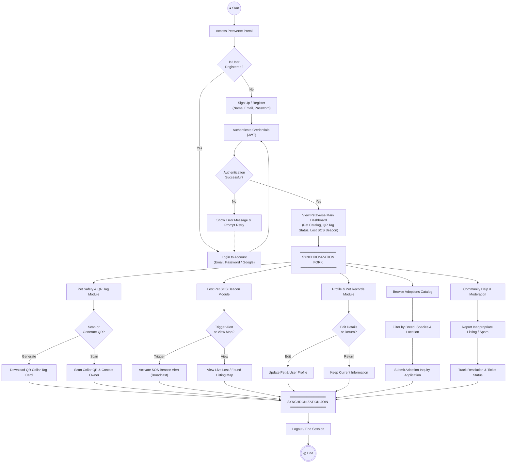
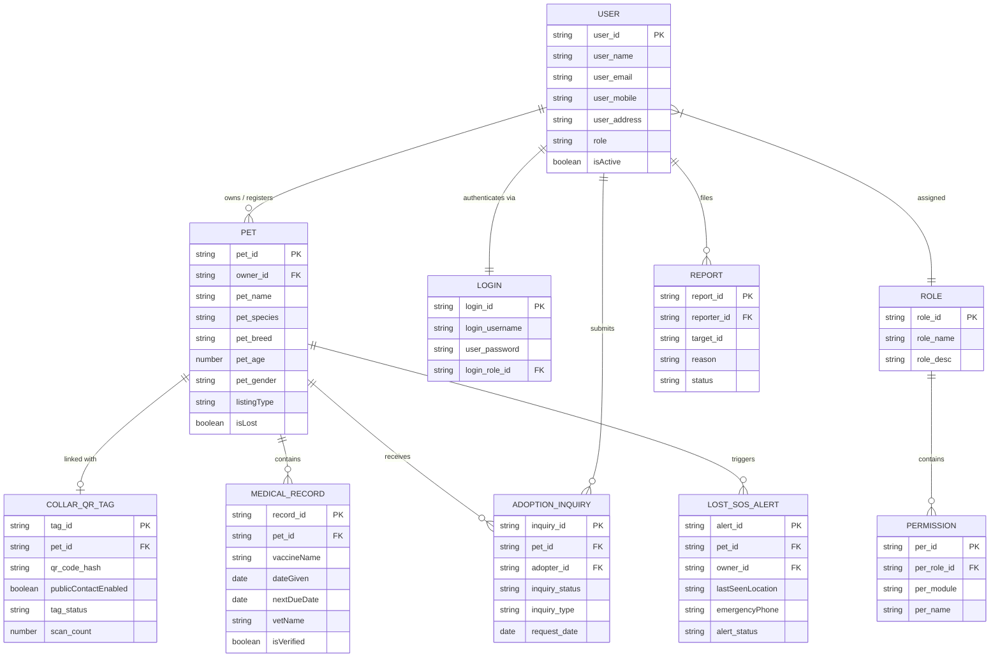

# Chapter 3: System Design & Architecture

## 3.1 System Architecture Diagram

The System Architecture of **Petaverse** follows a modern **Three-Tier Architecture**, which cleanly separates the system into distinct presentation, application logic, and data storage layers. This architectural decoupling ensures high scalability, maintainability, responsive user experiences, and enhanced security.

---

### Architectural Layers Overview

1. **Presentation Layer (Frontend / Client Tier):**
   - Built with **React 18**, **Vite**, and **Tailwind CSS**.
   - Manages interactive user interfaces including pet listing, pet registration, adoption management, and instant QR collar tag generation/scanning.
   - Utilizes Redux Toolkit / React Context for predictable client-side state management and Axios for asynchronous HTTP REST API communication.

2. **Application / Business Logic Layer (Backend Tier):**
   - Built using **Node.js** and **Express.js**.
   - Handles route handling, request validation, authentication via JWT and Google OAuth2, rate limiting, and business logic execution (such as Lost Pet SOS triggers, collar tag linking, and adoption approval workflows).
   - Serves as the secure mediator between client requests and database queries.

3. **Data Layer (Database & Storage Tier):**
   - **MongoDB Atlas** (via Mongoose ODM) provides persistent storage for user credentials, pet medical histories, QR registration data, and adoption applications.
   - **Cloudinary CDN** handles optimized cloud asset storage for pet photos and vaccination records.

---

### Request-Response Data Flow Cycle

---

### Diagram Asset

- High-Resolution Vector Diagram: `docs/blackbook/system_architecture_diagram.svg`

## 3.2 Use-Case Diagram

The Use-Case diagram models the interactions between the primary external actors (**Admin**, **Moderator / Sub-Admin**, and **Pet Owner / Adopter**) and the core functional capabilities of the **Petaverse Portal**. It outlines system boundaries, access restrictions, and dependencies (`<<include>>` and `<<extend>>` associations).

---

### Actor Definitions

1. **Admin (System Administrator):**
   - Possesses unrestricted platform access.
   - Manages user accounts, configures pet categories, oversees overall adoption workflows, reviews audit logs, and monitors analytics.

2. **Sub-Admin / Moderator:**
   - Granted limited, operational administration privileges.
   - Responsible for moderating incoming pet adoption/safety profiles, monitoring community reports, and assisting in tracking active Lost Pet SOS broadcasts.

3. **Pet Owner / Adopter (Standard User):**
   - Registers and manages personal pet profiles.
   - Generates and downloads digital QR collar tags.
   - Triggers one-click Lost Pet SOS alerts to activate community beacon mode.
   - Explores, filters, and saves pets for adoption, and submits adoption inquiries or inappropriate content reports.

---

### Diagram Asset

- Vector File (Pure White Background for Black Book print): `docs/blackbook/use_case_diagram.svg`

## 3.3 Sequence Diagram

The Sequence Diagram captures the chronological sequence of messages and interactions exchanged between system lifelines during critical Petaverse user workflows.

### Lifelines & Participants:
1. **Pet Owner (Actor):** End user initiating actions.
2. **Web UI (Presentation Layer):** React 18 single-page application handling forms and local state.
3. **API Server (Application Layer):** Express.js / Node.js backend executing route handlers and middleware validation.
4. **Database Services (Data Layer):**
   - **Auth DB:** MongoDB user credentials and JWT validation.
   - **Pet DB:** Pet profiles, breeds, age, and health records.
   - **Media & SOS DB:** Cloudinary image URLs and real-time Lost Pet beacon registries.

### Workflows Modeled:
- **Flow 1: User Login & JWT Authentication:** User submits credentials -> Backend validates hash -> Returns JWT bearer token -> UI initializes session dashboard.
- **Flow 2: Pet Registration & Collar QR Tag Generation:** User submits multipart pet data -> Backend persists entity and computes QR code hash -> Returns `201 Created` with QR Tag modal payload.
- **Flow 3: Lost Pet SOS Community Alerting:** User toggles SOS switch -> Backend transitions pet status to `lost` and activates public contact beacon -> UI displays urgent alert banner.

- High-Res Diagram: `docs/blackbook/3.3_Sequence_Diagram.png`
- Vector SVG: `docs/blackbook/3.3_Sequence_Diagram.svg`

---

## 3.4 Class Diagram

The Class Diagram defines the structural object model of Petaverse, outlining class attributes, operational methods, access visibility (`+` public, `-` private), inheritance hierarchies, and multiplicities.

### Core Classes & Associations:
1. **User (Superclass):** Encapsulates core identity properties (`userId`, `name`, `email`, `password`, `role`).
2. **Admin & Shelter_Manager (Specializations):** Inherit from `User` to add operational and governance privileges.
3. **Pet:** Central entity representing pet profiles (`name`, `species`, `listingType`, `isLost`). Associated with `User` with cardinality `1 : *`.
4. **MedicalRecord:** Tracks vaccination dates and vet details. Connected to `Pet` with cardinality `1 : *`.
5. **Report:** Handles community flags for duplicate or inappropriate posts (`1 : *` with User).
6. **SavedPet:** Represents user favorites / wishlists (`1 : *` with User).
7. **AdoptionInquiry:** Manages adoption requests submitted by potential adopters (`1 : *` with User).

- High-Res Diagram: `docs/blackbook/3.4_Class_Diagram.png`
- Vector SVG: `docs/blackbook/3.4_Class_Diagram.svg`

---

## 3.5 Activity Diagram

The Activity Diagram models the dynamic operational control flow of the Petaverse portal from initial entry to session logout.

### Mermaid Activity Flowchart Code:

### Workflow Stages Modeled:
1. **Entry & Authentication:** Starts at portal load, branches through registration/login verification, handles error handling with retry loops, and transitions to authenticated session state.
2. **Dashboard Synchronization Fork:** A horizontal synchronization fork branches the user's session concurrently into five distinct operational domains:
   - **Pet Safety & QR Collar:** Generating and downloading digital collar cards or scanning stray animal collar tags.
   - **Lost Pet SOS Tracking:** Triggering real-time broadcast beacons or viewing the live lost/found pet community map.
   - **Profile & Pet Management:** Updating personal contact details, medical records, and pet profiles.
   - **Adoption Exploration:** Searching, filtering, and lodging adoption inquiries.
   - **Community Moderation:** Reporting spam or fraudulent listings and tracking resolution tickets.
3. **Session Convergence & Termination:** All branches converge at the join bar leading to explicit logout and final termination.

- High-Res Diagram: `docs/blackbook/3.5_Activity_Diagram.png`
- Vector SVG: `docs/blackbook/3.5_Activity_Diagram.svg`

---

## 3.6 E-R Diagram

The Entity-Relationship (E-R) diagram models the logical data architecture of Petaverse.

### Mermaid ER Diagram Code:

### Entity Sets:
- **User:** Primary identity storing credentials, contact info, and profile records (`#user_id`).
- **Login:** Authentication session credentials (`#login_id`, `login_username`, `user_password`).
- **Roles & Permission:** Role-based access control governing platform privileges (`#role_id`, `#per_id`).
- **Pet:** Core animal profile entity (`#pet_id`, `pet_name`, `pet_species`, `pet_breed`, `pet_age`, `pet_gender`).
- **Adoption:** Formal adoption inquiry linking prospective adopters with listings (`#inquiry_id`).
- **MedicalRecord:** Vaccination histories and veterinary certificates (`#record_id`).
- **CollarQRTag:** Digital collar QR tag metadata and finder contact configurations (`#tag_id`, `qr_code_hash`).

### Relationships:
- **Has:** Connects `User` with `Login` credentials, assigned `Roles`, and operational `Permission` sets.
- **Manage:** Primary enterprise relationship connecting authenticated users with pet profiles, adoption workflows, collar QR tags, and medical records.

- High-Res Diagram: `docs/blackbook/3.6_ER_Diagram.png`
- Vector SVG: `docs/blackbook/3.6_ER_Diagram.svg`

---

## 3.7 Object Diagram

The Object Diagram illustrates a snapshot of runtime object instances, attribute values, and link associations in Petaverse at a specific point in time.

### Concrete Instances Depicted:
- `admin1 : Admin` (Super Admin Raj, ID: A101)
- `user1 : PetOwner` (Registered pet parent Amit Sharma, ID: U201)
- `pet1 : Pet` (Registered Golden Retriever "Bruno", ID: PT401)
- `tag1 : CollarQRCode` (Active Collar QR tag linked to Bruno, ID: QR501)
- `sos1 : LostAlert` (Standby safety beacon for Bruno in Andheri, Mumbai, ID: S601)
- `perm1 : Permission` (Pet SOS & Safety module access granted to admin1, ID: P701)
- `report1 : ModerationReport` (Community duplicate listing report assigned for review, ID: R301)

- High-Res Diagram: `docs/blackbook/3.7_Object_Diagram.png`
- Vector SVG: `docs/blackbook/3.7_Object_Diagram.svg`

## 3.8 Data Dictionary

### 1. User Collection (`users`)
| Field Name | Data Type | Description |
| :--- | :--- | :--- |
| `_id` (PK) | ObjectId | Unique identifier for user account |
| `name` | String | Full name of pet parent or administrator |
| `email` | String (Unique) | User email address used for login and notifications |
| `password` | String | Bcrypt salted encrypted password hash |
| `role` | String (Enum) | User role: 'user' \| 'admin' |
| `phone` | String | Contact phone number for lost pet finder calls |
| `location` | String | City and address of registered pet owner |
| `isActive` | Boolean | Account active / suspension status flag |
| `createdAt` | Date | Account creation timestamp |

### 2. Pet Collection (`pets`)
| Field Name | Data Type | Description |
| :--- | :--- | :--- |
| `_id` (PK) | ObjectId | Unique identifier for pet listing |
| `ownerId` (FK) | ObjectId | Reference to User who registered the pet |
| `name` | String | Pet's registered name |
| `species` | String (Enum) | Species: 'dog', 'cat', 'bird', 'rabbit', 'other' |
| `breed` | String | Specific breed identifier |
| `age` | Number | Age value of the pet |
| `ageUnit` | String (Enum) | Age unit: 'days', 'weeks', 'months', 'years' |
| `gender` | String (Enum) | Gender: 'male', 'female', 'unknown' |
| `listingType` | String (Enum) | Type: 'adoption', 'rehoming', 'safety', 'lost', 'found' |
| `status` | String (Enum) | Listing status: 'available', 'pending', 'adopted', 'resolved' |
| `photos` | Array<Object> | Cloudinary media image objects (url, public_id) |
| `isLost` | Boolean | Active Lost Pet SOS beacon alert flag |

### 3. Collar QR Tag Collection (`qr_tags`)
| Field Name | Data Type | Description |
| :--- | :--- | :--- |
| `_id` (PK) | ObjectId | Unique identifier for QR collar tag |
| `petId` (FK) | ObjectId | Reference to Pet linked to this tag |
| `qrHash` | String (Unique) | Cryptographic hash code encoded in the QR tag |
| `publicContactEnabled` | Boolean | Whether scanning displays owner contact details |
| `emergencyNote` | String | Critical medical or behavioral guidance for finders |
| `scanCount` | Number | Total counter of tag scans |
| `lastScannedAt` | Date | Timestamp of latest collar tag scan |

### 4. Lost Pet SOS Alert Collection (`sos_alerts`)
| Field Name | Data Type | Description |
| :--- | :--- | :--- |
| `_id` (PK) | ObjectId | Unique identifier for SOS alert instance |
| `petId` (FK) | ObjectId | Reference to Pet missing |
| `ownerId` (FK) | ObjectId | Reference to User who triggered the SOS |
| `lastSeenLocation` | String | Address or landmark where pet was last seen |
| `emergencyPhone` | String | Direct hotline contact for finders |
| `reward` | Number | Optional reward offered for pet return |
| `status` | String (Enum) | Alert status: 'active_lost' \| 'found' \| 'resolved' |

### 5. Medical Record Collection (`medical_records`)
| Field Name | Data Type | Description |
| :--- | :--- | :--- |
| `_id` (PK) | ObjectId | Unique identifier for vaccination / health log |
| `petId` (FK) | ObjectId | Reference to Pet receiving care |
| `vaccineName` | String | Name of vaccine administered (e.g. Rabies, DHPP) |
| `dateGiven` | Date | Date vaccine was administered |
| `nextDueDate` | Date | Scheduled booster or next checkup date |
| `vetName` | String | Name of treating veterinarian or clinic |
| `isVerified` | Boolean | Verification status confirmed by shelter moderator |

### 6. Adoption Inquiries & Reports Collection
| Field Name | Data Type | Description |
| :--- | :--- | :--- |
| `_id` (PK) | ObjectId | Unique identifier for inquiry or report |
| `petId` (FK) | ObjectId | Target pet listing |
| `applicantId` (FK) | ObjectId | User submitting inquiry or incident report |
| `type` | String (Enum) | Record type: 'adoption_inquiry' \| 'abuse_report' |
| `message` | String | Application cover letter or violation description |
| `status` | String (Enum) | Status: 'pending' \| 'approved' \| 'resolved' \| 'dismissed' |
| `submittedAt` | Date | Submission timestamp |
