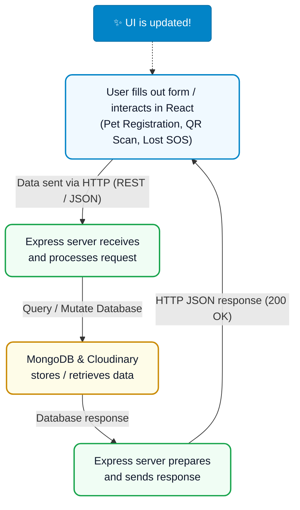
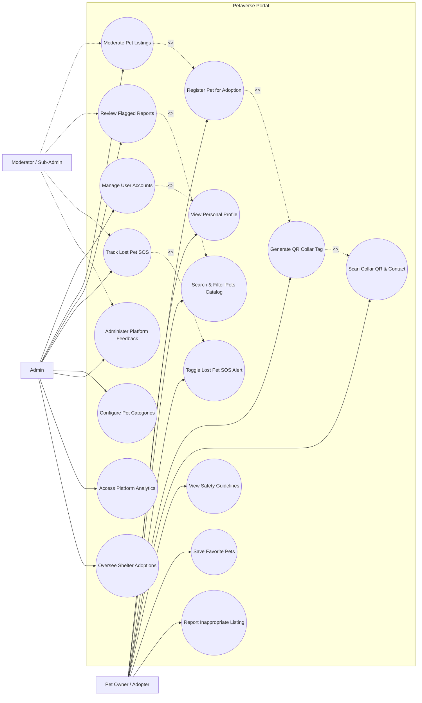

# Chapter 3: System Design & Architecture

## 3.1 System Architecture Diagram

The System Architecture of **Petaverse** follows a modern **Three-Tier Architecture**, which cleanly separates the system into distinct presentation, application logic, and data storage layers. This architectural decoupling ensures high scalability, maintainability, responsive user experiences, and enhanced security.

---

### Architectural Layers Overview

1. **Presentation Layer (Frontend / Client Tier):**
   - Built with **React 18**, **Vite**, and **Tailwind CSS**.
   - Manages interactive user interfaces including pet listing, pet registration, adoption management, and instant QR collar tag generation/scanning.
   - Utilizes Redux Toolkit / React Context for predictable client-side state management and Axios for asynchronous HTTP REST API communication.

2. **Application / Business Logic Layer (Backend Tier):**
   - Built using **Node.js** and **Express.js**.
   - Handles route handling, request validation, authentication via JWT and Google OAuth2, rate limiting, and business logic execution (such as Lost Pet SOS triggers, collar tag linking, and adoption approval workflows).
   - Serves as the secure mediator between client requests and database queries.

3. **Data Layer (Database & Storage Tier):**
   - **MongoDB Atlas** (via Mongoose ODM) provides persistent storage for user credentials, pet medical histories, QR registration data, and adoption applications.
   - **Cloudinary CDN** handles optimized cloud asset storage for pet photos and vaccination records.

---

### Request-Response Data Flow Cycle

---

### Diagram Asset

- High-Resolution Vector Diagram: `docs/blackbook/system_architecture_diagram.svg`

## 3.2 Use-Case Diagram

The Use-Case diagram models the interactions between the primary external actors (**Admin**, **Moderator / Sub-Admin**, and **Pet Owner / Adopter**) and the core functional capabilities of the **Petaverse Portal**. It outlines system boundaries, access restrictions, and dependencies (`<<include>>` and `<<extend>>` associations).

---

### Actor Definitions

1. **Admin (System Administrator):**
   - Possesses unrestricted platform access.
   - Manages user accounts, configures pet categories, oversees overall adoption workflows, reviews audit logs, and monitors analytics.

2. **Sub-Admin / Moderator:**
   - Granted limited, operational administration privileges.
   - Responsible for moderating incoming pet adoption/safety profiles, monitoring community reports, and assisting in tracking active Lost Pet SOS broadcasts.

3. **Pet Owner / Adopter (Standard User):**
   - Registers and manages personal pet profiles.
   - Generates and downloads digital QR collar tags.
   - Triggers one-click Lost Pet SOS alerts to activate community beacon mode.
   - Explores, filters, and saves pets for adoption, and submits adoption inquiries or inappropriate content reports.

---

### Diagram Asset

- Vector File (Pure White Background for Black Book print): `docs/blackbook/use_case_diagram.svg`

## 3.3 Sequence Diagram

The Sequence Diagram captures the chronological sequence of messages and interactions exchanged between system lifelines during critical Petaverse user workflows.

### Lifelines & Participants:
1. **Pet Owner (Actor):** End user initiating actions.
2. **Web UI (Presentation Layer):** React 18 single-page application handling forms and local state.
3. **API Server (Application Layer):** Express.js / Node.js backend executing route handlers and middleware validation.
4. **Database Services (Data Layer):**
   - **Auth DB:** MongoDB user credentials and JWT validation.
   - **Pet DB:** Pet profiles, breeds, age, and health records.
   - **Media & SOS DB:** Cloudinary image URLs and real-time Lost Pet beacon registries.

### Workflows Modeled:
- **Flow 1: User Login & JWT Authentication:** User submits credentials -> Backend validates hash -> Returns JWT bearer token -> UI initializes session dashboard.
- **Flow 2: Pet Registration & Collar QR Tag Generation:** User submits multipart pet data -> Backend persists entity and computes QR code hash -> Returns `201 Created` with QR Tag modal payload.
- **Flow 3: Lost Pet SOS Community Alerting:** User toggles SOS switch -> Backend transitions pet status to `lost` and activates public contact beacon -> UI displays urgent alert banner.

- High-Res Diagram: `docs/blackbook/3.3_Sequence_Diagram.png`
- Vector SVG: `docs/blackbook/3.3_Sequence_Diagram.svg`

---

## 3.4 Class Diagram

The Class Diagram defines the structural object model of Petaverse, outlining class attributes, operational methods, access visibility (`+` public, `-` private), inheritance hierarchies, and multiplicities.

### Core Classes & Associations:
1. **User (Superclass):** Encapsulates core identity properties (`userId`, `name`, `email`, `password`, `role`).
2. **Admin & Shelter_Manager (Specializations):** Inherit from `User` to add operational and governance privileges.
3. **Pet:** Central entity representing pet profiles (`name`, `species`, `listingType`, `isLost`). Associated with `User` with cardinality `1 : *`.
4. **MedicalRecord:** Tracks vaccination dates and vet details. Connected to `Pet` with cardinality `1 : *`.
5. **Report:** Handles community flags for duplicate or inappropriate posts (`1 : *` with User).
6. **SavedPet:** Represents user favorites / wishlists (`1 : *` with User).
7. **AdoptionInquiry:** Manages adoption requests submitted by potential adopters (`1 : *` with User).

- High-Res Diagram: `docs/blackbook/3.4_Class_Diagram.png`
- Vector SVG: `docs/blackbook/3.4_Class_Diagram.svg`

---

## 3.7 Object Diagram

The Object Diagram illustrates a snapshot of runtime object instances, attribute values, and link associations in Petaverse at a specific point in time.

### Concrete Instances Depicted:
- `admin1 : Admin` (Super Admin Raj, ID: A101)
- `user1 : PetOwner` (Registered pet parent Amit Sharma, ID: U201)
- `pet1 : Pet` (Registered Golden Retriever "Bruno", ID: PT401)
- `tag1 : CollarQRCode` (Active Collar QR tag linked to Bruno, ID: QR501)
- `sos1 : LostAlert` (Standby safety beacon for Bruno in Andheri, Mumbai, ID: S601)
- `perm1 : Permission` (Pet SOS & Safety module access granted to admin1, ID: P701)
- `report1 : ModerationReport` (Community duplicate listing report assigned for review, ID: R301)

- High-Res Diagram: `docs/blackbook/3.7_Object_Diagram.png`
- Vector SVG: `docs/blackbook/3.7_Object_Diagram.svg`
